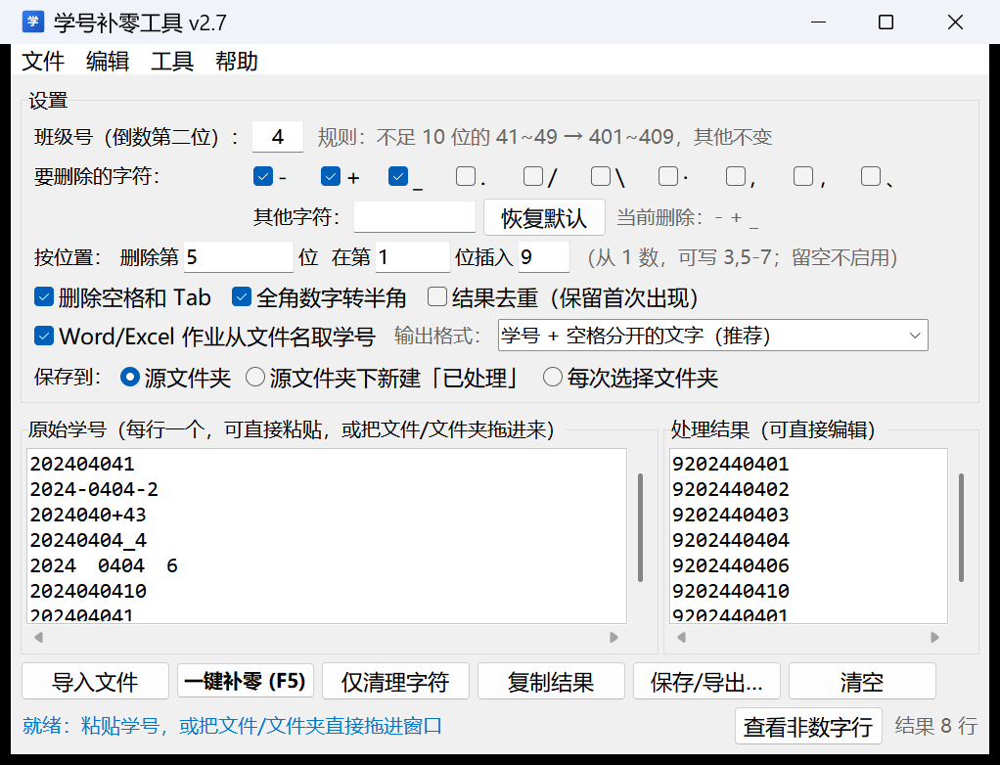

# 学号补零工具 v2.5.2

一个 Windows 小工具：把从 Excel、网页或聊天记录里复制来的学号整理成统一格式——
**先删除多余字符，再按规则补 0**。可以直接粘贴文本，也可以把**文件或整个文件夹拖进窗口**。



> 仓库：<https://github.com/Ric-Kopa/FileReNameAss-For-RicKopa>
> 不想装 Python 的话，直接到 [Releases](https://github.com/Ric-Kopa/FileReNameAss-For-RicKopa/releases/latest)
> 下载打包好的 exe：
> `student-id-tool-v2.3.0-singlefile.exe`（单文件版）或
> `student-id-tool-v2.3.0-folder.zip`（文件夹版，解压后双击 `学号补零工具.exe`，推荐）。

## 补零规则

学号倒数第二位是班级号（默认 `4`），最后一位是学生序号 `1~9` 时，在最后一位前补 `0`：

| 原始 | 结果 |
| --- | --- |
| `202404041` | `2024040401` |
| `2024040410` | `2024040410`（已经是完整 10 位，不变） |
| `202404043` | `2024040403` |

**长度 ≥ 10 位的学号一律原样保留**，不再参与补零判断。这样即使班级号是 `1`、`2`、`3`
（这时已补好的 10 位学号倒数第二位恰好等于班级号），也不会被重复补 0。

班级号可以在界面上改（只要 1 位数字），规则提示会跟着变。

## 删除指定字符

复制来的学号经常夹着 `-`、`+`、`_` 这类符号：

```
2024-0404-1  ->  202404041  ->  2024040401
2024040+42   ->  202404042  ->  2024040402
```

「设置 → 要删除的字符」现在是一排勾选框，**默认勾上 `-` `+` `_`**：

| 勾选框 | 说明 |
| --- | --- |
| `-` `+` `_` `.` `/` `\` `·` `,` `，` `、` | 学号里常见分隔符，点一下勾上/取消 |
| **其他字符** 输入框 | 列表里没有的符号自己填，例如 `@#*`，可以和勾选框一起用 |
| **恢复默认** | 一键回到只勾 `-` `+` `_`、其他为空 |

右侧会实时显示「当前删除：- + _」，一眼看清现在到底删哪些字符。

处理顺序（每一行）：

1. 去掉首尾空白和零宽字符、BOM；
2. 全角数字/符号转半角（`２０２４` → `2024`，全角空格 → 空格）；
3. 删除你填写的字符；
4. 勾选「删除空格和 Tab」时，若去掉空白后整行都是数字，就把内部空格也压掉
   （`2024 0404 1` → `202404041`）——多列数据（如 `学号 姓名`）不会被破坏；
5. 勾选「结果去重」时，完全相同的学号只保留第一次出现的；
6. 纯数字的行按规则补 0；不是数字的行**原样保留**在结果里，并在状态栏提示行数，
   点「查看非数字行」可以看到是第几行。

### 按位置删 / 插字符

有些学号不是“多了符号”而是“某一位多了/少了东西”，用「设置 → 按位置」：

| 输入 | 含义 |
| --- | --- |
| 删除第 `3` 位 | 只删第 3 个字符 |
| 删除第 `3,5-7` 位 | 删第 3、5、6、7 位（可混写，倒着写 `7-5` 也对） |
| 在第 `4` 位插入 `0` | 在第 4 个字符**前面**插一个 `0`；`10` 表示末尾追加 |

位置**从 1 开始数**，且是在“删完字符之后”的文本上算（先清理、再按位置、最后补零）：

```
2024-0404-1   --删除第5位-->  20244041  --补零-->  202440401
202404041     --第4位插入0--> 2020404041
```

留空表示不启用；点「恢复默认」会一起清空。

两个按钮的区别：

- **一键补零**：先清理字符，再补 0；
- **仅清理字符**：只删字符、不补 0，适合想自己再加工的情况。

## 导入文件 / 拖拽文件夹

- **拖进来**：把 `.txt`、`.csv` 等文本文件，或者**整个文件夹**，直接用鼠标拖到窗口里即可，
  文件夹会被递归读取（只挑文本后缀：`.txt .csv .tsv .log .md .dat`，最多 300 个文件）；
- **菜单**：「文件 → 导入文件…（可多选）」「文件 → 导入文件夹…」（`Ctrl+Shift+O`）；
- 文本框里已有内容时，会先问一句要不要替换，避免误覆盖；
- 单个文件超过 20 MB、合并后超过 200 万字符时会停止读取并提示，防止界面卡住。

### Word / Excel 作业：从文件名取学号

作业通常按「学号-姓名-作业名」命名，里面的学号才是要的，内容反而不重要：

```
25179704-08-何金森-作业一.doc   ->  2517970408
25179704-09-侯添悦-作业一.doc   ->  2517970409
2024-0404-1-张三.docx           ->  202404041   （不足 10 位，补零后再用）
```

勾选「**Word/Excel 作业从文件名取学号**」（默认勾选）后，把整个作业文件夹拖进来即可。
**只替换开头的学号，后面的姓名、作业名原样保留**，输出格式可选：

| 输出格式 | `25179704-08-何金森-作业一.doc` 变成 |
| --- | --- |
| 学号 + 空格分开的文字（默认） | `2517970408 何金森 作业一` |
| 保留原文件名（含扩展名） | `2517970408-何金森-作业一.doc` |
| 保留原文件名（去扩展名） | `2517970408-何金森-作业一` |

- 读不了内容的文件（Word / Excel / PDF）自动退回到**文件名开头的数字**；
- 只认文件名开头、可由 `- _ . + 空格` 分隔的数字串，至少 6 位，后面必须紧跟非数字字符，
  所以 `作业一.doc`、`第3组.doc` 不会被误认；
- 学号最多取 10 位数字，所以 `2517970408-08-李四.docx` 不会被当成 12 位学号；
- 读得了的文本文件（txt/csv 等）仍然优先读内容，两种方式可以混着拖；
- 直接粘在左边框里的 `202404041 张三 作业一` 这类行，也只会改学号、保留后面的文字；
- 状态栏会写清楚「N 个文件名 / M 个文本文件」。

### 保存 / 导出：要文件，不要清单

点「**保存/导出…**」（`Ctrl+S`）会问你要输出什么：

| 选项 | 结果 |
| --- | --- |
| **重命名后的文件（复制）** ← 推荐 | 把文件**复制**到目标文件夹，文件名换成新学号，原文件一个不动 |
| 重命名后的文件（直接改源文件） | 在源文件夹里**原地改名**，不可撤销 |
| 学号清单 学号处理结果.txt | 只有学号文本清单，方便核对 |

拖入一整个作业文件夹后选第一项，得到的就是**改好名的真实文件**：

```
源文件夹                                     目标文件夹
25179704-08-何金森-作业一.doc      ──copy──▶  2517970408 何金森 作业一.doc
25179704-09-侯添悦-作业一.doc      ──copy──▶  2517970409 侯添悦 作业一.doc
扫描件.pdf                         ──跳过──   （文件名里没有学号）
```

- 扩展名一律保留，所以 Word 还是 `.doc`、Excel 还是 `.xlsx`；
- 目标文件夹里已有同名文件时自动加 ` (2)`、` (3)`，**不会覆盖**别人的文件；
- 文件名本来就对的文件会被跳过，不会产生重复副本；
- 对话框里会写清楚「几个文件可改名 / 几个会被跳过」；
- 导出前会先检测目标文件夹能不能写；写不进去时（常见于火绒 / 联想电脑管家的「文档保护」
  拦住未信任程序），可以直接改用程序旁边的「导出」文件夹，或把程序加入杀毒软件信任区；
- 某个文件被 Word/Excel 占用时会自动等 0.2 秒重试一次，仍失败就跳过它、继续处理其余文件，
  最后列出失败清单，不会整批中断。

### 保存位置

「保存到」有三个选项，默认**源文件夹**（就是你刚刚拖进来的那个文件夹）：

- **源文件夹**：结果写回该文件夹；
- **源文件夹下新建「已处理」**：生成 `原文件夹名-已处理/`，不动原文件夹（推荐和「重命名后的文件（复制）」一起用）；
- **每次选择文件夹**：弹出选择框，默认定位到源文件夹。

导出完可以直接点「是」打开文件夹。清单用 `utf-8-sig` 写入，Excel 打开不乱码。

## 运行

需要 Python 3.9+，只用标准库（Tkinter），无需安装第三方包。

```bat
python main.py
```

或者双击 `run.bat`（会自动优先使用项目里的 `.venv`，并切到 UTF-8 代码页）。

## 快捷键

| 快捷键 | 功能 |
| --- | --- |
| `F5` / `Ctrl+Enter` | 一键补零 |
| `Ctrl+L` | 仅清理字符 |
| `Ctrl+O` | 导入文件 |
| `Ctrl+Shift+O` | 导入文件夹 |
| `Ctrl+S` | 保存结果 |
| `Ctrl+Shift+C` | 复制结果 |
| `Ctrl+A` | 全选当前文本框 |

## 一些小细节

- 保存结果默认用 `utf-8-sig` 编码，Excel 直接双击打开不会乱码；
- 导入文件会依次尝试 `utf-8-sig` / `utf-8` / `gb18030`，不会像旧版那样用
  `errors="ignore"` 悄悄吞掉字符；
- 设置（班级号、要删除的字符、三个复选框）会存到同目录的 `settings.json`，
  下次打开自动恢复；
- 支持撤销（左侧输入框 `Ctrl+Z`）、拖选、直接编辑右侧结果。

## 目录结构

```
main.py                 图形界面（Tkinter）
student_id_core.py      核心逻辑：清理字符、补零、读文件/文件夹、统计（不依赖界面）
file_drop.py            把文件/文件夹拖进窗口的 Windows 拖放封装
tests/                  单元测试 + 界面冒烟测试
docs/screenshot.png     界面截图
run.bat                 双击启动
settings.json           运行后自动生成，保存界面设置
```

## 测试

```bat
python -m unittest discover -s tests -v
```

共 59 个用例：`tests/test_student_id_core.py` 覆盖补零规则（含 1/2/3 班与 10 位学号）、
字符清理、全角/零宽字符、去重、仅清理模式、编码回退、文件夹读取；
`tests/test_gui_smoke.py` 真实创建窗口，验证按钮、复选框和拖放回调（没有图形环境时自动跳过）。

## 打包成 exe

两种形态都在 `dist\` 下：

| 产物 | 说明 |
| --- | --- |
| `dist\学号补零工具-文件夹版\学号补零工具-文件夹版.exe` | **推荐**。文件夹版（onedir），双击即用，启动快、不依赖临时目录 |
| `dist\学号补零工具-文件夹版.zip` | 文件夹版的压缩包（发到 GitHub Release 用） |
| `dist\学号补零工具-单文件版.exe` | 单文件版（onefile），拷贝方便，但启动时会先解压到系统临时目录 |

打包命令：

```bat
pip install pyinstaller
:: 文件夹版
pyinstaller --noconfirm --onedir --noconsole --name 学号补零工具-文件夹版 ^
  --icon app-icon.ico --add-data "app-icon.ico;." main.py
:: 单文件版
pyinstaller --noconfirm --onefile --noconsole --name 学号补零工具-单文件版 ^
  --icon app-icon.ico --add-data "app-icon.ico;." main.py
```

> 注意：如果某台机器的系统临时目录被安全策略限制，单文件版启动时会弹
> `Could not create temporary directory!`，此时请改用文件夹版（它不需要解压）。

打包后 `settings.json` 会保存到 exe 所在目录。
